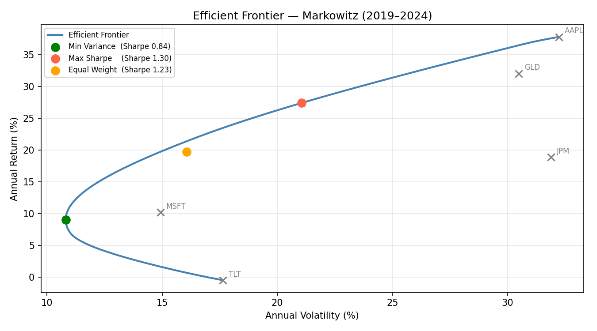
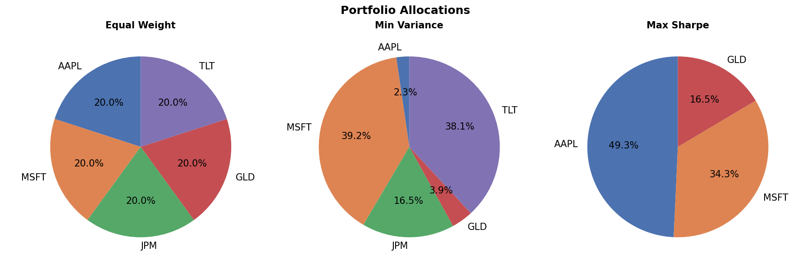
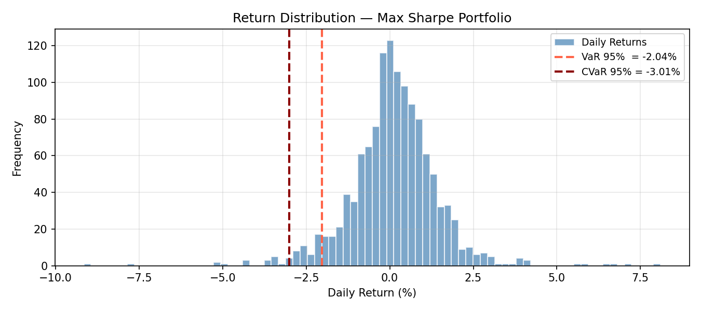

# Markowitz Portfolio Optimization

> Mean-variance portfolio optimization with efficient frontier, Sharpe ratio maximization and risk metrics (VaR/CVaR).

---

## Overview

For my second quantitative finance project, I implemented Harry Markowitz's Modern Portfolio Theory from scratch — the mathematical framework behind rational asset allocation. Given a set of risky assets, the model finds the optimal capital allocation that either minimizes risk for a target return, or maximizes the risk-adjusted return (Sharpe ratio). Risk is further quantified through Value-at-Risk and Conditional Value-at-Risk metrics.

Built on top of 5 years of real market data (2019–2024) across five assets : AAPL, MSFT, JPM, GLD (gold), and TLT (long-term US Treasuries) — intentionally diversified across equities, commodities and fixed income.

---

## Theory

### Returns & Covariance

For a portfolio of **n assets** with weight vector **w** (∑wᵢ = 1, wᵢ ≥ 0) :

$$\mu_p = w^\top \mu, \qquad \sigma_p^2 = w^\top \Sigma w$$

where **μ** is the vector of annualized expected returns and **Σ** the annualized covariance matrix (scaled by 252 trading days).

### Sharpe Ratio

$$S = \frac{\mu_p - r_f}{\sigma_p}$$

The Sharpe ratio measures return per unit of risk. We use $r_f = 5\%$ as the risk-free rate.

### Efficient Frontier

The efficient frontier is the set of portfolios that minimize volatility for each level of target return. It is obtained by solving, for each target $\mu^*$ :

$$\min_w \; w^\top \Sigma w \quad \text{s.t.} \quad w^\top \mu = \mu^*, \quad \sum w_i = 1, \quad w_i \geq 0$$

Two portfolios of particular interest lie on the frontier :
- **Minimum Variance Portfolio** — lowest achievable risk
- **Maximum Sharpe Portfolio** — best risk-adjusted return (tangency portfolio)

### Value-at-Risk & CVaR

**Historical VaR** at confidence level α : the loss not exceeded with probability α, computed directly from observed returns — no distributional assumption.

**CVaR (Expected Shortfall)** : the average loss in the worst $(1-\alpha)$ scenarios :

$$\text{CVaR}_\alpha = -\mathbb{E}[r \mid r < -\text{VaR}_\alpha]$$

CVaR is a coherent risk measure and more informative than VaR alone — it captures tail risk.

---

## Results

Parameters : **5 assets, 2019–2024, $r_f = 5\%$, confidence = 95%**

### Portfolio Comparison

| Metric | Equal Weight | Min Variance | Max Sharpe |
|--------|-------------|--------------|------------|
| **Annual Return** | 19.70% | 9.07% | 27.40% |
| **Annual Volatility** | 16.07% | 10.81% | 21.05% |
| **Sharpe Ratio** | 1.2257 | 0.8382 | 1.3019 |
| **VaR 95% (daily)** | 1.41% | 1.05% | 2.04% |
| **CVaR 95% (daily)** | 2.30% | 1.47% | 3.01% |

### Max Sharpe Allocation

| Asset | Weight | Role |
|-------|--------|------|
| AAPL | 49.27% | Growth |
| MSFT | 34.28% | Growth |
| GLD | 16.46% | Hedge |
| JPM | 0.00% | — |
| TLT | 0.00% | — |

The optimizer fully allocates to US tech and gold — JPM and TLT are excluded as their risk-adjusted contributions are dominated over this period.

### Visualizations


*Efficient frontier with individual assets (×), minimum variance portfolio (green) and maximum Sharpe portfolio (red).*


*Capital allocation across the three portfolio strategies.*


*Daily return distribution of the Max Sharpe portfolio with VaR and CVaR thresholds.*

---

## Project Structure

```
markowitz-portfolio/
├── data.py          # Price download via yfinance (2019–2024)
├── portfolio.py     # Annualization, optimization, efficient frontier
├── var.py           # Historical VaR, CVaR, parametric VaR
├── plots.py         # Efficient frontier, allocations, return distribution
└── main.py          # Entry point — prints all portfolio statistics
```

---

## Usage

```bash
# Install dependencies
pip install numpy scipy matplotlib yfinance

# Run portfolio optimization
python main.py

# Generate visualizations
python plots.py
```

---

## References

- Markowitz, H. (1952). *Portfolio Selection*. Journal of Finance.
- Rockafellar, R. & Uryasev, S. (2000). *Optimization of Conditional Value-at-Risk*. Journal of Risk.
- Hull, J. (2022). *Options, Futures, and Other Derivatives* (11th ed.). Pearson.